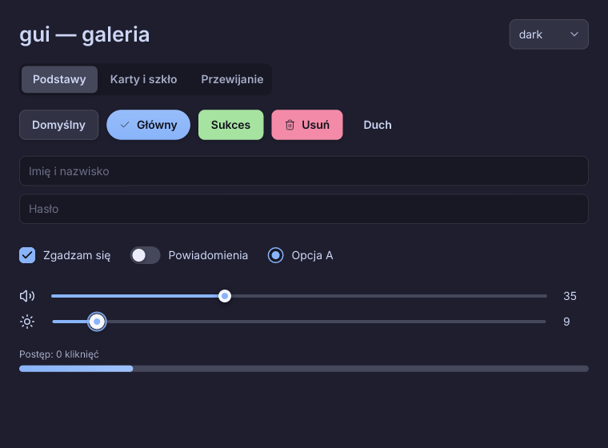
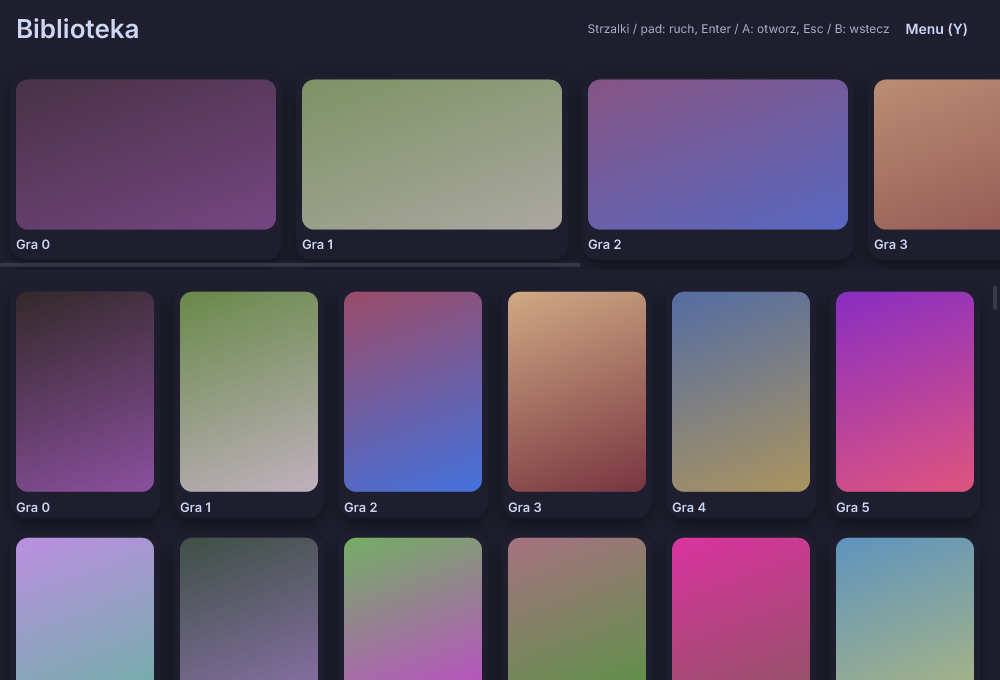

# gui — lekka biblioteka GUI dla HackerScript i bit

Biblioteka `gui` dla **HackerScript** (pakiet **bit**): programy piszesz w stylu **iced** (`State` → `view` → `Message` → `update`),
wygląd jest inspirowany **Slint** i **HTML/CSS** (zaokrąglenia, gradienty, cienie, szkło z rozmyciem tła, arkusze CSS),
a pod spodem działa własny, mały rasteryzator 2D. Obsługuje **Wayland**, **X11/XWayland** oraz protokoły potrzebne do napisania
**czystej powłoki** (panel, dok, launcher, ekran blokady, powiadomienia, lista okien).

* 100% kodu w plikach `.hcs` — brak plików `.rs`. Cienka warstwa systemowa (rasteryzator, Wayland, X11) to bloki `native {Rust}`
  w `lib/native.hcs`, tak jak w `hack3rc`; cały interfejs (widgety, layout, style, CSS, zdarzenia, powłoka) jest napisany w HackerScript.
* Mały: przykładowy program z wszystkimi backendami to **ok. 2,1 MB** (czcionki Inter + 67 ikon wchodzą w skład: ~110 KB).
* Bez zależności C: Wayland przez `wayland-client` (czysty Rust), X11 przez `x11rb`, rysowanie `tiny-skia`, tekst `ttf-parser`.



## Szybki start

```hcs
get <bit:gui>

struct State [ value: Int ]

fun update(state: State, m: Message) -> State [
    let s = state.clone()
    if m.id == "inc" [ s.value = s.value + 1 ]
    if m.id == "dec" [ s.value = s.value - 1 ]
    end s
]

fun view(state: State) -> Element [
    let body = column([
        text(state.value as Str).size(56.0).bold(),
        row([ button("−").on_press("dec"), button("+").on_press("inc").class("primary") ]).spacing(10.0)
    ]).spacing(16.0).align_x(1)
    end container(body).center().padding(24.0)
]

fun main() [
    let app = app_new("Licznik", 360, 300)
    let state = State(0)
    while app.running() [
        for m in app.frame1(view(state.clone())) [
            state = update(state.clone(), m)
        ]
    ]
]
```

`app.frame1(ui)` rysuje (gdy trzeba), czeka na zdarzenia i zwraca listę `Message`. Widgety zwracają komunikaty o nazwie podanej w `.on_press("nazwa")`,
`.on_toggle`, `.on_change`, `.on_input`, `.on_submit`, `.on_select`. Pola `Message`: `id`, `text`, `num` (suwak), `flag` (checkbox/toggler/radio), `idx` (zakładki/lista), `win`.

## Instalacja i budowanie

1. Skopiuj katalog `gui/` do katalogu bibliotek bit i wskaż go kompilatorowi:
   ```sh
   mkdir -p ~/bit-libs && cp -r gui ~/bit-libs/      # dowolny katalog; kompilator szuka go przez BIT_LIBS
   export BIT_LIBS=~/bit-libs
   hackerc build examples/counter/cmd/main.hcs -o out --crate-name counter --libs-root <HackerScript>/libs
   cd out && cargo build --release
   ```
   (wpis do indeksu bit.io: `docs/bit-index-entry.json` — po opublikowaniu repozytorium wystarczy `get <bit:gui>` w projekcie).
2. Wymagania: HackerScript 0.5, **Rust ≥ 1.86** (wymóg `wayland-protocols 0.32`), przy Waylandzie opcjonalnie `libxkbcommon.so.0`
   (ładowana w czasie działania przez `dlopen`; bez niej działa zapasowy układ US + polski programisty z AltGr).
3. Zmienne: `GUI_BACKEND=wayland|x11|headless|auto`, `GUI_SCALE=1.5` (X11), `GUI_DEBUG=1` (log zdarzeń).

## Widgety

`column` `row` `stack` `container` `scrollable` `space` `rule` `text` `icon` `canvas` `button` `button_with` `text_input` (kursor, zaznaczenie, Ctrl+A/C/X/V, słowa, `.secret()`)
`checkbox` `toggler` `radio` `slider` `progress_bar` `pick_list` (lista rozwijana) `tabs` `tooltip` `image` (JPEG/PNG/WebP) `modal` `drawer` `virtual_grid` `virtual_scrollable` `scrollable_x` · gotowe: `card` `badge` `heading` `caption` `vspace` `hspace`.
Układ jak w iced: `shrink() fixed(px) fill() portion(n)`, `padding` `margin` `spacing` `align_x/align_y` `center`, zawijanie tekstu, przewijanie kółkiem,
nawigacja klawiaturą (Tab, Enter, Spacja, strzałki), animowane przejścia hover/press/focus.
Opis wyglądu, motywów i CSS: **docs/STYLING.md**.

## Launchery i aplikacje „konsolowe” (0.2)



Obrazy rastrowe z cache, gamepady (evdev), nawigacja przestrzenna 2D z pułapkami fokusu, wirtualna siatka/lista, zadania w tle (`gui_inject_message`, `task_*`), skalowanie aktywnego kafelka i animowane przewijanie — opis: **docs/LAUNCHER.md**.

## Powłoka (Wayland)

Panel, launcher z listą aplikacji (`.desktop`), pasek zadań, zegar, blokada sesji, powiadomienia, OSD — klocki w `gui::shell`, przykłady w `examples/shell` i `examples/lock`.
Opis: **docs/SHELL.md**. Protokoły i status testów: **docs/PROTOCOLS.md**.

## Przykłady

| Katalog | Co pokazuje |
|---|---|
| `examples/counter` | najprostszy program w stylu iced, przełączanie motywu |
| `examples/todo` | lista zadań: pole z Enter, checkboxy, zakładki, przewijanie |
| `examples/showcase` | galeria widgetów, karty, gradient, szkło, zmiana motywu, CSS |
| `examples/launcher` | launcher gier: okładki, siatka 320 pozycji (wirtualna), karuzela, nawigacja padem/strzałkami, modal, szuflada, zadania w tle |
| `examples/shell` | panel + pasek zadań + zegar + launcher (layer-shell, foreign-toplevel) |
| `examples/lock` | ekran blokady (ext-session-lock) |

## Testy

`tests/run.sh` buduje i uruchamia `tests/cases/suite.hcs` w trybie headless (bez kompozytora): kolory, CSS, layout, renderowanie do PNG,
kliknięcia/pisanie/suwak/zakładki/lista/Tab/przewijanie przez wstrzykiwane zdarzenia, klocki powłoki, pomiar wydajności (ok. 120 sprawdzeń, w tym obrazy, nawigacja, pad, modal, wirtualizacja i zadania w tle).

## Znane ograniczenia (HackerScript 0.5 wpływające na API)

* Komunikaty to `Message` z tekstowym `id` zamiast własnego `enum` (kompilator nie ma ograniczeń generyków, więc nie da się `Element<Message>`).
* Argumenty wywołania nie mogą zaczynać się w nowej linii zaraz po `(` — zbuduj wartość w `let` (listy `[ … ]` mogą być wieloliniowe).
* Kompilator nie wykrywa mutacji parametru przez wywołanie metody: trzymaj pętlę z `app` w `main` albo wywołaj `app.clear()` w funkcji pomocniczej przyjmującej `app`.
* Brak literałów `0x…`: kolory przez `rgb(r,g,b)`, `rgba(...)`, `parse_color("#89b4fa")`. `.len()` liczy bajty — używaj `slen()` do długości w znakach.
* Identyfikatory generowane automatycznie zaczynają się od `@` — własnych `.id("…")` możesz używać dowolnie, byle bez `@`.

Pełne zestawienie tego, co jest przetestowane, a co tylko zaimplementowane: **docs/PROTOCOLS.md**.

## Licencje
MIT (`LICENSE`). Czcionka Inter (OFL 1.1) i ikony Lucide (ISC) oraz zależności: `THIRD_PARTY.md`.
